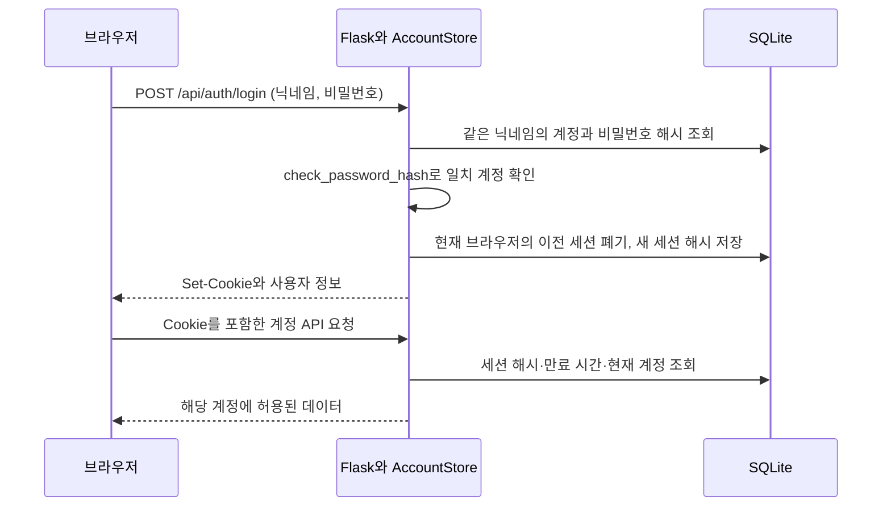

# 회원가입·로그인 체계 구현 인수인계

- 프로젝트: **딥러닝 기반 AI 두피 관리 서비스**
- 기준일: **2026-11-03**
- 운영 범위: 대회용 로컬 시연
- 기준 소스: 이 문서와 같은 폴더의 현재 작업 코드

이 문서는 회원가입·로그인, 서버 세션, 계정별 기록 저장, 관리자 권한을 이어 개발하기 위한 자료다. 전체 웹 실행·모델 설정은 [README.md](README.md), 과거 개발 이력은 [CODEX_HANDOFF.md](CODEX_HANDOFF.md)를 참고한다. 실제 운영 비밀번호·세션 토큰·회원 데이터는 이 문서에 포함하지 않는다. 아래 ID와 JSON 값은 설명용 예시다.

## 1. 현재 구현 요약

브라우저의 HTML/CSS/JavaScript와 Flask API가 같은 주소에서 동작한다. 계정과 세션은 SQLite에 저장하며 별도 DB 서버는 필요하지 않다.

| 구분 | 구현 내용 |
|---|---|
| 가입 정보 | 아이디(닉네임) + 비밀번호, 선택 동의한 성별 |
| 가입 직후 | 일반 회원 계정 생성 후 자동 로그인 |
| 닉네임 정책 | NFKC + casefold 키로 새 중복 차단. 이전 중복 계정은 보존 |
| 계정 식별 | 닉네임 대신 내부 숫자 ID 사용 |
| 비밀번호 저장 | Werkzeug 비밀번호 해시 |
| 로그인 유지 | 임의 세션 토큰을 HttpOnly 쿠키로 전달, DB에는 토큰 해시 저장 |
| 유지 기간 | 생성 시점부터 고정 7일 |
| 권한 | 일반 회원 `user`, 관리자 `admin` |
| 회원 기록 | SQLite에 계정별 분석 결과·관리 체크 저장 |
| 비회원 기록 | localStorage에 분석 결과와 날짜별 실천을 별도 키로 저장 |
| 관리자 생성 | 로컬 CLI 전용 도구로 생성 |

현재 인증은 Flask와 `sqlite3`를 이용해 직접 구현했다. Flask-Login, SQLAlchemy, JWT, 외부 인증 서비스는 사용하지 않는다. 성별은 성별에 따른 맞춤형 관리 안내를 위해 선택 동의 후 수집하며 나이·이메일·생년월일은 수집하지 않는다. 원하지 않으면 성별을 반영하지 않은 포괄적인 관리 방법을 제공한다. 사용자 화면은 회원가입·로그인·비밀번호 등 일반적인 서비스 표현을 사용한다. 시연용 비밀번호 예시와 로컬 실행 안내는 일반 화면에서 제거했으며, 아래의 입력 정책과 인증 동작은 유지한다.

## 2. 파일별 역할

| 파일 | 담당 역할·주요 진입점 |
|---|---|
| [accounts.py](accounts.py) | `AccountStore`: 테이블 생성·마이그레이션, 가입·로그인, 세션, 저장 서명, 계정별 데이터, 관리자 작업 |
| [server.py](server.py) | `create_app()`: API 라우트, 쿠키 설정, 로그인·관리자 검사, 출처·계정 버전 검사, JSON 오류 응답 |
| [dist/app.js](dist/app.js) | 로그인·가입 화면, `bootstrapAccount()`, `submitAuth()`, `logout()`, `accountRequest()`, 계정 전환 처리 |
| [dist/member.js](dist/member.js) | 회원정보 수정·아이디 중복 확인·선택 동의 폼 |
| [dist/member-care.js](dist/member-care.js) | 날짜별 체크·월별 달력·비회원 실천 저장·PDF 다운로드 |
| [dist/trends.js](dist/trends.js) | 내 기록의 항목별 변화 메뉴·개별 경로·월/최근 1주 조회 |
| [dist/admin.js](dist/admin.js) | 관리자 화면, 회원 초기화·삭제 확인, 임시 비밀번호 표시, 작업 내역 |
| [dist/index.html](dist/index.html) | 공통 메뉴·계정 메뉴, 스크립트 연결 |
| [dist/styles.css](dist/styles.css) | 인증·관리자 화면 스타일과 모바일 배치 |
| [dist/care.js](dist/care.js) | 분석 결과에 따른 관리 항목 선택. 로그인 자체를 처리하지 않음 |
| [scripts/manage_admin.py](scripts/manage_admin.py) | 로컬 관리자 계정 생성 CLI |
| [tests/test_accounts.py](tests/test_accounts.py) | 회원·세션·계정 격리·저장 서명 검증 |
| [tests/test_admin.py](tests/test_admin.py) | 관리자 권한·DB 전환·초기화·삭제·임시 비밀번호 검증 |
| [scripts/smoke_accounts.py](scripts/smoke_accounts.py) | 실제 브라우저의 가입·로그인·저장·관리 체크 검증 |
| [scripts/smoke_admin.py](scripts/smoke_admin.py) | 실제 브라우저의 관리자 작업 검증 |

## 3. 실행과 DB 위치

명령은 프로젝트의 `scalp-ai-demo` 폴더에서 실행한다. 이 PC에는 `.venv`가 준비되어 있다.

```powershell
powershell -ExecutionPolicy Bypass -File .\start.ps1
```

- 접속: `http://127.0.0.1:8000`
- 가입 화면: `http://127.0.0.1:8000/#register`
- 로그인 화면: `http://127.0.0.1:8000/#login`
- 관리자 화면: `http://127.0.0.1:8000/#admin`
- 종료: 실행 창의 서비스 종료 버튼 또는 창 닫기. 개발용 `start.ps1 -Console`은 터미널에서 Ctrl+C
- 포트 변경: `start.ps1 -Port 8001`

`start.cmd`로도 실행할 수 있다. `dist/index.html` 직접 열기나 Live Server만으로는 인증 API와 DB가 실행되지 않는다. 새 환경의 의존성 설치는 `setup.ps1`과 [requirements.txt](requirements.txt)를 따른다.

기본 DB는 **`data/scalp.sqlite3`**다. `SCALP_DB_PATH`가 있으면 해당 경로를 사용한다. 코드에서 `create_app(..., database_path=...)`를 지정하면 그 경로가 우선한다. 상대 경로는 실행 위치의 영향을 받으므로 별도 DB를 사용한다면 절대 경로를 지정하는 편이 명확하다.

```powershell
$env:SCALP_DB_PATH = 'D:\scalp-demo\scalp.sqlite3'
powershell -ExecutionPolicy Bypass -File .\start.ps1
```

DB 폴더와 테이블은 `AccountStore` 초기화 때 생성된다. 관리자 생성 CLI에도 같은 DB 경로를 사용해야 한다. 서버의 환경변수를 바꾸려면 서버를 다시 실행해야 한다.

## 4. 회원가입 정책과 처리

### 입력 규칙

| 항목 | 서버의 실제 처리 |
|---|---|
| 닉네임 | 문자열, 앞뒤 공백 제거 후 1~40자 |
| 닉네임 비교 | NFKC 정규화 + casefold의 `nickname_key`로 비교 |
| 비밀번호 | 문자열, 1~128자. 앞뒤 공백을 제거하지 않음 |
| 복잡도 | 숫자·특수문자 등 조합 조건 없음 |
| 닉네임 중복 확인 | 가입·수정 화면 버튼과 `GET /api/auth/nickname` 제공. 가입/수정 트랜잭션에서도 재검사 |
| 동일 닉네임 + 다른 비밀번호 | 새 가입 거절 `409` |
| 동일 닉네임 + 동일 비밀번호 | 새 가입 거절 `409` |
| 가입 권한 | 항상 `user`. 요청에 `role: "admin"`을 넣어도 관리자 계정이 생성되지 않음 |

비밀번호의 공백도 값의 일부다. 현재 구현은 공백만 있는 비밀번호를 복잡도 규칙으로 차단하지 않는다. 입력 정책을 바꾸려면 프런트엔드와 `AccountStore.credentials()`를 함께 확인해야 한다.

### 가입 순서

1. `#register`의 폼에서 닉네임·비밀번호를 입력한다.
2. `submitAuth()`가 `POST /api/auth/register`를 호출한다.
3. 서버가 JSON 형식과 입력 값을 검사한다.
4. `generate_password_hash()`로 비밀번호를 해시한다. 현재 설치 환경의 기본 방식은 `scrypt`다.
5. `BEGIN IMMEDIATE`에서 정규화한 키의 사용 여부를 재검사하여 동시 가입도 중복 차단한다. 성별과 명시적 동의의 일관성을 검사한다.
6. 새 계정을 `role=user`, `result_epoch=0`으로 저장한다.
7. 새 세션을 만들고 쿠키와 사용자 정보를 반환한다. 성공 코드는 `201`이다.
8. 웹은 현재 계정의 상태로 전환하고 사진 분석 화면으로 이동한다.

이전 중복 계정을 보존하기 위해 `nickname_key` 인덱스는 UNIQUE가 아니다. 새 가입·수정은 직렬화한 쓰기 트랜잭션으로 중복을 차단한다. 기존 데이터에 UNIQUE를 바로 추가하거나 계정을 삭제하지 않는다. 기록 접근·관리 작업의 기준은 내부 ID다.

### 회원정보 수정과 선택 동의

일반 회원은 `#profile`에서 현재 비밀번호를 확인한 뒤 아이디·비밀번호·성별과 동의를 수정한다. 관리자 수정은 로컬 CLI만 사용한다. 실제 정보 변경은 `profile_version`과 `result_epoch`를 올리고 이전 세션을 폐기한 다음 현재 브라우저에 새 세션을 발급한다. 기존 분석·관리 기록은 유지하며 미저장 결과는 재분석이 필요하다.

가입과 수정 화면에 수집 항목(성별), 목적(성별에 따른 맞춤형 관리), 보관 기간(동의 철회 또는 계정 삭제 시까지)을 안내한다. 체크박스는 선택이며 동의하지 않아도 가입·분석을 이용하고 성별을 반영하지 않은 포괄적인 관리 방법을 받는다. 동의 철회 시 `gender`, 동의 시각·동의 문구 버전을 NULL로 지우고 `gender_consent=0`으로 저장한다. 성별은 사진 모델의 입력으로 보내지 않는다. 새 비밀번호는 다른 서비스에서 쓰지 않는 값으로 안내한다.

사용자 응답은 기존 `id/nickname/role/result_epoch`에 `gender`, boolean `gender_consent`, `profile_version`을 추가한다. 사진 선택창 복귀에서 프로필 버전이 동일하면 DOM을 교체하지 않는 기존 보호를 유지한다.

## 5. 로그인·세션·로그아웃

### 로그인 흐름



`AccountStore.login()`은 같은 정규화 키의 계정을 ID 순으로 읽고 비밀번호를 대조한다. 이전 중복 계정의 로그인도 보존한다. 불일치 시 `401`로 닉네임·비밀번호 재확인을 안내한다. 로그인 실패만으로 이미 유효한 현재 세션을 로그아웃시키지는 않는다.

가입·로그인 성공 시 웹이 받는 사용자 정보 형식은 같다.

```json
{
  "user": {
    "id": 101,
    "nickname": "시연회원",
    "role": "user",
    "result_epoch": 0
  }
}
```

### 세션 저장과 쿠키

| 구분 | 구현 |
|---|---|
| 토큰 생성 | `secrets.token_urlsafe(32)` |
| 브라우저 | 원본 토큰을 `scalp_session` 쿠키로 보유 |
| DB | 원본 토큰 대신 SHA256 해시, 사용자 ID, 만료 시각 저장 |
| 만료 | 생성 시점부터 `604800`초, 즉 7일 |
| 자동 연장 | 없음. API를 사용한다고 만료 시간이 연장되지 않음 |
| 권한 판정 | 매 요청의 세션 조회 시 DB의 현재 `role`을 읽음 |

쿠키는 `HttpOnly`, `SameSite=Lax`, `Path=/`로 설정한다. `Secure`는 Flask가 HTTPS 요청으로 판단할 때 설정되며 기본 로컬 HTTP에서는 설정되지 않는다. JavaScript가 세션 토큰을 localStorage에 저장하거나 직접 읽는 방식이 아니다.

`new_session()`은 현재 브라우저가 보낸 이전 토큰과 만료된 세션을 정리한다. 다른 브라우저의 유효한 세션을 모두 종료하지는 않는다. 로그인 확인과 세션 발급 사이에 관리자 초기화가 발생하면 데이터 버전을 확인해 오래된 인증 결과의 세션 발급을 막는다.

### 현재 로그인 확인과 로그아웃

- `GET /api/auth/me`는 유효한 세션이면 위 사용자 정보를, 비로그인이면 `{"user": null}`을 반환한다. 비로그인도 응답 코드는 `200`이다.
- `POST /api/auth/logout`은 **현재 요청의 토큰만** DB에서 삭제하고 쿠키를 제거한다.
- 관리자 비밀번호 초기화는 해당 회원의 **모든 세션**을 종료한다. 일반 로그아웃과 범위가 다르다.
- 만료된 토큰의 DB 행이 남아 있더라도 만료 검사로 로그인은 허용되지 않는다. 별도 주기 청소 작업은 없으며 새 세션 생성 때 만료 행을 정리한다.

## 6. DB 구조

`sqlite3` 연결마다 `PRAGMA foreign_keys=ON`을 적용한다. 연결은 작업 후 닫고, 트랜잭션 안에서 예외가 나면 롤백한다.

| 테이블 | 주요 필드·역할 |
|---|---|
| `users` | `id` PK, `nickname`, `nickname_key`, `password_hash`, `created_at`, `role`, `result_epoch`, `profile_version`, `gender`, `gender_consent`, `gender_consented_at`, `gender_consent_version` |
| `sessions` | `token_hash` PK, `user_id` FK, `expires_at` |
| `records` | `(user_id, record_id)` 복합 PK, `record_date`, 분석 결과 JSON인 `payload` |
| `care_checks` | `(user_id, check_date)` 복합 PK, 체크 항목 목록 JSON인 `checks` |
| `metadata` | `key` PK, `value`. 결과 저장 서명용 `signing_secret` 보관 |
| `admin_actions` | 실행자·대상 ID와 닉네임, 작업 종류, 시각, 처리 건수 JSON |

- `users.id`는 계정 삭제 후 다른 계정의 인증 정보로 재사용하지 않도록 자동 증가 ID를 사용한다.
- 가입 시각·세션 만료·관리 작업 시각은 UNIX 초 단위다. 웹의 날짜 표시는 한국 시간대를 사용한다.
- `sessions`, `records`, `care_checks`의 사용자 FK는 `ON DELETE CASCADE`이므로 회원 삭제 시 관련 행도 삭제한다.
- 관리자 작업 내역은 대상 ID·닉네임을 별도로 보관하므로 대상 회원 삭제 후에도 남는다.
- 원본 두피 사진·파일명·비밀번호 원문·세션 원문 토큰은 DB에 저장하지 않는다.
- DB에는 비밀번호 해시와 서명 비밀값 등 인증에 필요한 정보가 있다. DB·백업 파일은 공개 저장소나 공유 인수인계 문서에 첨부하지 않는다.

### 기존 DB 전환

`AccountStore.__init__()`은 테이블을 확인하고, 이전 `users` 테이블에 없는 `role`과 `result_epoch`를 추가한다. 기존 회원은 `role=user`, `result_epoch=0`으로 유지한다. 기존 ID·비밀번호 해시·가입일·분석 기록·관리 체크·세션을 덮어쓰지 않는다. 새 필드가 없으면 `nickname_key`를 채우고 성별 NULL·동의 false·profile_version 0으로 추가한다. 이전 중복 계정도 그대로 보존한다.

전환은 `BEGIN IMMEDIATE`로 직렬화하고 컬럼 존재 여부를 검사하므로 반복 실행할 수 있다. 기존 첫 회원을 자동으로 관리자로 승격하지 않는다. 이후 스키마 변경도 기존 DB 보존 테스트를 추가한 뒤 적용한다.

## 7. 인증 및 계정 API

계정 API 응답은 JSON이며 `POST /api/report/pdf`의 성공 응답은 PDF 파일이다. JSON 본문을 보내는 요청에는 `Content-Type: application/json`을 사용한다. 분석 업로드인 `POST /api/analyze`는 multipart를 사용하며 GET 요청과 일반 회원의 `DELETE /api/records`에는 본문이 없다.

| 메서드·주소 | 로그인 | 주요 요청 / 응답 |
|---|---|---|
| `POST /api/auth/register` | 불필요 | `{nickname,password,gender?,gender_consent?}` → `201`, `{user}` + 쿠키 |
| `POST /api/auth/login` | 불필요 | `{nickname, password}` → `200`, `{user}` + 쿠키 |
| `GET /api/auth/me` | 불필요 | `{user}` 또는 `{user:null}` |
| `GET /api/auth/nickname?nickname=...` | 불필요 | `{nickname,available}` |
| `GET /api/auth/profile` | 필요 | 본인 `{user}` |
| `PATCH /api/auth/profile` | 일반 회원 | `{current_password,nickname?,new_password?,gender?,gender_consent?}` → `{user}` + 새 쿠키 |
| `POST /api/auth/logout` | 불필요 | JSON `{}` → `{user:null}` + 쿠키 제거 |
| `GET /api/records` | 필요 | `{records:[...]}` |
| `POST /api/records` | 필요 | `{record, save_token}` → `{record}`. 새 저장 `201`, 같은 ID 재저장 `200` |
| `DELETE /api/records` | 필요 | `{deleted:건수}`. 현재 계정의 분석 기록만 삭제 |
| `GET /api/care-checks?date=YYYY-MM-DD` | 필요 | `{date, checks:[...]}` |
| `GET /api/care-checks?month=YYYY-MM` | 필요 | `{month,days:[{date,checks}]}` |
| `POST /api/report/pdf` | 불필요 | `{result}` → 한글 PDF 첨부파일 |
| `PUT /api/care-checks` | 필요 | `{date, checks:[허용ID]}` → 같은 형식 |

`GET /api/health`와 `POST /api/analyze`는 비회원도 사용할 수 있다. 회원 API는 사용자가 전달한 임의의 `user_id`로 접근 대상을 선택하지 않으며 서버 세션의 사용자 ID를 사용한다.

관리 체크 ID는 `gentle-wash`, `low-heat`, `observe`, `flakes-care`, `sebum-care`, `hair-care`, `redness-care`다. 날짜 유효성과 ID 중복·허용 목록을 서버에서도 검사한다.

### 오류 응답

```json
{
  "error": "사용자에게 표시할 설명",
  "code": "data_changed"
}
```

`error`는 문자열이며 `code`는 일부 오류에만 포함한다.

| 상태·코드 | 의미 |
|---|---|
| `400` | 입력 값·날짜·JSON 내용·대상 계정 확인 값 오류 |
| `401` | 로그인 필요 또는 로그인 정보 불일치 |
| `403` | 관리자 권한 부족, 다른 출처의 쓰기 요청, 유효하지 않은 결과 저장 서명 등 |
| `404` | 관리 대상 계정·API 없음 |
| `409` | 정규화한 아이디 중복, 계정·데이터·프로필 버전 충돌 등 |
| `413` | 요청 용량 제한 초과 |
| `415` | JSON API에 잘못된 Content-Type 사용 |
| `500` | DB 작업 등 서버 오류. 상세 원인은 서버 로그 확인 |
| `409 / account_changed` | 웹이 알고 있는 계정 ID와 현재 세션 계정이 다름 |
| `409 / data_changed` | 웹 또는 진행 중 요청의 데이터 버전이 현재 계정과 다름 |
| `403 / admin_required` | 관리자 전용 기능을 현재 권한으로 이용할 수 없음 |
| `409 / profile_changed` | 브라우저가 보낸 프로필 버전이 현재 값과 다름 |
| `403 / password_mismatch` | 회원정보 수정 시 현재 비밀번호 불일치 |

계정 검사 전에 헤더 충돌을 발견하면 비로그인 요청도 `401` 대신 `409`가 먼저 반환될 수 있다. 프런트엔드에서 상태 숫자만 보고 처리하지 말고, 존재하는 경우 `code`도 확인한다.

## 8. 브라우저 상태와 계정 전환

| 함수·상태 | 역할 |
|---|---|
| `validUser()` | 사용자 ID·닉네임·권한·데이터 버전의 응답 형식 검사 |
| `bootstrapAccount()` | 시작 시 `/api/auth/me` 확인 후 계정별 기록·관리 체크 로드 |
| `submitAuth()` | 가입·로그인 폼 전송, 성공 시 계정 상태 전환 |
| `jsonRequest()` | 같은 출처 쿠키를 보내는 JSON 요청, 12초 제한·오류 정리 |
| `accountRequest()` | 계정·버전 헤더 추가 및 만료·권한·버전 변경 처리 |
| `resetAccountScope()` | 이전 결과·사진·개인 기록·관리 체크·관리자 캐시를 비우고 비동기 응답 버전 증가 |
| `state.accountEpoch` | 브라우저 메모리의 요청 세대 번호. 이전 계정의 늦은 응답을 무시하기 위한 값 |
| `user.result_epoch` | DB의 결과 저장 버전. 관리자 초기화 후 서명·요청 유효성을 판단하는 값 |
| `checkAccountOnFocus()` | 창 복귀 시 계정 ID·권한·데이터·프로필 버전을 조용히 확인 |

`state.accountEpoch`와 DB의 `result_epoch`는 다른 개념이다. 서로 같은 값으로 맞추거나 한쪽을 없애면 계정 전환의 응답 경합 처리와 서버의 초기화 처리가 깨질 수 있다.

### 계정 ID·버전 헤더

웹은 계정 API와 분석 요청에 아래 헤더를 붙인다.

```http
X-Scalp-Account: 101
X-Scalp-Result-Epoch: 0
X-Scalp-Profile-Version: 0
```

비회원의 계정 헤더는 `guest`이며 데이터 버전 헤더는 생략한다. 서버는 `/api/records`, `/api/care-checks`, `/api/analyze`, `/api/auth/profile`, `/api/report/pdf`, `/api/admin/*`에서 **헤더가 제공된 경우** 현재 세션과 대조한다. 이 헤더는 인증 수단이 아니며 쿠키의 서버 세션을 대체하지 않는다.

다른 탭의 로그인으로 쿠키가 바뀌면 `account_changed`, 관리자 초기화로 데이터 버전이 달라지면 `data_changed`를 반환한다. 웹은 이전 계정의 사진·결과·기록·관리자 정보를 지우고 현재 로그인 정보를 다시 확인한다. 비동기 응답도 `accountEpoch`와 관리자 `generation`을 비교해 이전 상태에 적용되지 않도록 한다.

### 사진 선택창 복귀 수정 유지

운영체제의 파일 선택창을 닫을 때도 window `focus` 이벤트가 발생한다. 이때 `bootstrapAccount()`를 무조건 실행해 전체 DOM을 다시 만들면 파일 입력칸이 교체되어 선택한 사진의 `change` 이벤트가 전달되지 않는다.

현재 `checkAccountOnFocus()`는 계정 ID·권한·버전이 그대로이면 화면과 입력칸을 유지한다. 이 흐름을 일반적인 전체 새로고침으로 바꾸지 않는다. 관련 회귀 검사는 [scripts/smoke_web.py](scripts/smoke_web.py)에 있다.

## 9. 비회원·회원 기록과 저장 서명

### 저장 위치 구분

| 상태 | 분석 결과 | 관리 체크 |
|---|---|---|
| 비회원 | localStorage `scalp-ai-model-records-v2` | localStorage `scalp-ai-care-days-v1` 날짜별 |
| 로그인 회원 | 서버 `records` 테이블 | 서버 `care_checks` 테이블, 계정·날짜별 |

로그인해도 기존 비회원 기록을 삭제하거나 계정에 자동 이관하지 않는다. 로그인 상태에서는 계정 기록을, 로그아웃하면 같은 브라우저의 비회원 기록을 보여준다. 가입·로그인·로그아웃 등 계정 전환 시 선택 사진과 아직 저장하지 않은 결과는 초기화한다.

분석 사진은 서버 메모리에서 처리한다. 로그인 여부와 관계없이 원본 사진을 DB나 localStorage에 보관하지 않는다.

### `save_token`의 역할

1. 서버가 분석 결과를 생성하면 `sign_result()`가 저장 허가용 서명을 발급한다.
2. 서명은 **계정 ID(비회원은 guest) + result_epoch + 정규화한 결과의 SHA256**을 메시지로 만들고, DB의 `metadata.signing_secret`으로 HMAC-SHA256을 계산한다.
3. 웹은 `save_token`을 아직 저장하지 않은 결과의 메모리 상태에 보관한다.
4. 회원이 저장하면 서버는 현재 사용자·현재 버전·결과 내용이 모두 일치하는지 검증한다.
5. 서명 검증과 실제 INSERT를 하나의 `BEGIN IMMEDIATE` 트랜잭션에서 처리한다. 관리자 초기화와 저장이 동시에 발생해도 예전 결과가 다시 들어가는 경합을 막는다.

다른 계정의 결과·내용을 변경한 결과·비회원으로 분석한 결과를 회원 계정으로 넘기는 저장은 거절한다. 계정에 보관할 결과는 로그인 후 다시 분석한다. DB에 저장하는 `payload`에는 `save_token`을 넣지 않는다.

`canonical()`은 JSON 키 순서·공백을 정리하고 정수 값의 실수를 정수로 맞춘다. 브라우저가 `1.0`을 `1`로 직렬화해도 동일한 수치 때문에 서명 검증이 실패하지 않게 하는 처리다. 이를 단순 문자열 비교로 바꾸지 않는다.

**`save_token`에는 별도 시간 만료가 없다.** 로그인 세션의 7일 만료와 혼동하지 않는다. 계정·버전·결과 내용·서명 비밀값에 따라 유효성이 달라진다. 분석이 진행되는 동안 관리자가 초기화하면 요청 시작 시점의 버전으로 서명하여 오래된 요청이 새 버전의 저장 허가를 받지 않도록 한다.

### 실천 기록과 PDF

체크리스트는 `#history`에 있으며 오늘·지난 날짜를 선택해 실천을 저장한다. 분석 변화 메뉴는 `#trend/flakes`, `#trend/sebum`, `#trend/hair_loss`, `#trend/erythema`로 이동해 선택한 항목만 그린다. 각 화면에 월 선택·최근 1주·내 기록 복귀가 있고, `graphRecords()`의 설정 식별자 경계를 유지한다. 피지 무/유와 이전 3등급은 별도의 곡선·축을 사용한다. 미래 날짜 쓰기는 서버에서 차단하고 월별 내역은 현재 계정만 반환한다. `careLoadToken`/`careMonthToken`과 계정 세대 번호로 늦은 응답이 다른 날짜·계정·저장 직후의 달력 표시를 덮어쓰지 않도록 한다. 분석 결과만 삭제할 때는 실천 기록을 보존한다.

`#care`는 사진 등급·선택 동의한 성별에 따른 안내와 제품 선택 기준을 표시한다. 근거·성분 제안 제한은 [CARE_GUIDANCE.md](CARE_GUIDANCE.md)를 참고한다. 이메일 전송은 구현하지 않았다. 결과 화면은 인쇄 창을 열지 않고 ReportLab으로 한글 PDF를 내려받으며 표시 등급은 원시 확률에서 서버가 다시 계산한다. 사진 원본·확률·비밀번호는 PDF에 넣지 않는다. PDF 내보내기를 결과 저장 서명 인증과 혼동하지 않는다.

## 10. 관리자 권한과 초기화 범위

관리자 화면은 메뉴 표시만으로 보호하지 않는다. `server.py`의 `require_admin()`과 `AccountStore`의 관리자 작업에서 DB의 현재 권한을 확인한다. 회원가입 시 관리자 권한을 선택할 수 없으며, 첫 회원을 자동 승격하지 않는다.

| 작업 | 대상·서버 처리 |
|---|---|
| 운영 현황·회원 목록 | 계정 수·저장 기록 수·가입일·ID·권한·관리 날짜 수 조회. 회원 비밀번호·개별 분석 결과 내용은 반환하지 않음 |
| 모델 상태 | 4개 모델 준비 상태와 로딩 실패 원인 확인 |
| 임시 비밀번호 발급 | 일반 회원에게 새 8자리 숫자 발급. 현재 비밀번호 및 같은 닉네임의 다른 계정과 겹치면 다시 생성 |
| 기록 초기화 | 선택 일반 회원의 분석 결과·관리 체크 삭제 |
| 계정 삭제 | 선택 일반 회원 및 관련 세션·분석 결과·관리 체크 삭제 |
| 작업 내역 | 실행자·대상 ID와 닉네임·시각·처리 건수 기록. 비밀번호 원문은 남기지 않음 |

관리자 API는 다음과 같다.

| 주소 | 응답·요청 요약 |
|---|---|
| `GET /api/admin/overview` | `{counts, health}` |
| `GET /api/admin/users` | `{users:[...]}` |
| `GET /api/admin/actions` | `{actions:[...]}`, 기본 최근 50건 |
| `POST /api/admin/users/<id>/reset-password` | JSON `{}` → `{user, temporary_password, revoked_sessions}` |
| `POST /api/admin/users/<id>/clear-data` | `{confirm_user_id:<id>}` → 삭제 건수 |
| `DELETE /api/admin/users/<id>` | `{confirm_user_id:<id>}` → 삭제 건수·종료 세션 수 |

초기화·삭제는 웹의 확인창과 서버의 대상 ID 검사를 거친다. 웹에서는 관리자 자신과 다른 관리자 모두 수정·초기화·삭제 대상으로 처리하지 않는다. 일반 회원만 관리할 수 있다.

### 로그아웃·초기화의 차이

| 작업 | 계정 유지 | 세션 | 분석 기록 | 관리 체크 | result_epoch |
|---|---|---|---|---|---|
| 일반 로그아웃 | 유지 | 현재 토큰만 삭제 | 유지 | 유지 | 유지 |
| 회원의 내 기록 모두 삭제 | 유지 | 유지 | 삭제 | 유지 | 유지 |
| 관리자의 비밀번호 초기화 | 유지 | 해당 회원의 모든 토큰 삭제 | 유지 | 유지 | 1 증가 |
| 관리자의 기록 초기화 | 유지 | 유지 | 삭제 | 삭제 | 1 증가 |
| 관리자의 회원 삭제 | 삭제 | 연관 토큰 삭제 | 연관 기록 삭제 | 연관 체크 삭제 | 계정과 함께 삭제 |

관리자의 기록 초기화 후에는 예전 저장 서명을 다시 사용할 수 없다. 회원 자신의 기록 삭제는 의도적으로 범위가 다르며, 버전을 올리거나 관리 체크를 함께 지우지 않는다.

임시 비밀번호는 발급 응답에서 한 번 전달하고 관리자 화면 메모리에만 표시한다. 다른 화면으로 이동·로그아웃·권한 변경 시 표시를 제거한다. 웹은 비밀번호를 복구해 보여주는 것이 아니라 새 비밀번호를 발급하는 방식이다.

## 11. 관리자 생성 도구

기존 운영 계정의 인증 정보는 담당자에게 별도로 전달받는다. 이 문서에 실제 초기 비밀번호를 적지 않는다.

프로젝트 폴더의 로컬 터미널에서 실행한다.

```powershell
.\.venv\Scripts\python.exe scripts\manage_admin.py create --nickname "운영자"
```

비밀번호를 두 번 숨김 입력받는다. 자동 생성이 필요하면 다음을 실행한다.

```powershell
.\.venv\Scripts\python.exe scripts\manage_admin.py create --nickname "운영자" --generate-password
```

자동 생성은 `secrets.token_urlsafe(12)`를 사용하며 현재 16자 문자열이다. 일반 회원 초기화용 8자리 숫자와 다르다. 자동 생성 명령은 `{user, temporary_password}` JSON을 출력하므로 출력 내용을 운영자가 보관해야 한다. 비밀번호를 소스·공유 문서·Git에 붙여 넣지 않는다.

별도 DB를 사용할 때는 `--database`를 **create 앞에** 지정한다.

```powershell
.\.venv\Scripts\python.exe scripts\manage_admin.py --database 'D:\scalp-demo\scalp.sqlite3' create --nickname "운영자" --generate-password
```

현재 CLI는 **관리자 생성만 지원**한다. 기존 회원 승격, 관리자 비밀번호 변경·복구, 관리자 삭제 명령은 없다. 운영자 추가 생성은 가능하지만 기존 관리자 계정을 교체·정리하는 별도 기능은 구현하지 않았다.

기존 관리자 변경: `scripts/manage_admin.py update --user-id <ID> --nickname <새아이디>`. 비밀번호는 숨김 입력하며 자동화에서만 `--password-stdin`으로 한 줄을 전달한다. ID·기록을 유지하고 기존 세션을 폐기하며 작업 내역에 `admin_credentials_updated`를 남긴다. 실제 비밀번호는 코드에 넣지 않는다.

## 12. 구현된 요청 보호와 현재 범위

- API의 POST·PUT·PATCH·DELETE에서 `Origin`이 서버 주소와 다르거나 `Sec-Fetch-Site`가 `cross-site`이면 거절한다.
- 가입·로그인·로그아웃·기록 저장·관리 체크 변경·관리자 변경처럼 `json_body()`로 본문을 읽는 요청은 `application/json`을 요구한다. 일반 회원의 `DELETE /api/records`는 본문·Content-Type을 요구하지 않는다. 분석 업로드는 multipart 경로를 사용한다.
- API 응답은 `Cache-Control: no-store`, 응답에는 `X-Content-Type-Options: nosniff`를 설정한다.
- SQL의 사용자 입력은 파라미터로 전달한다. 비밀번호와 세션 원문은 DB에 보관하지 않는다.
- 화면의 역할 정보는 메뉴·안내용이며 최종 접근 권한은 서버에서 판정한다.

이 구성은 로컬 시연을 기준으로 한다. 별도의 CSRF 토큰 체계, 로그인 시도 제한, 이메일 인증, 소셜 로그인, 회원의 자체 비밀번호 찾기·변경, 임시 비밀번호의 다음 로그인 강제 변경은 구현하지 않았다. 계정 ID·버전 헤더를 일반적인 인증 토큰이나 CSRF 토큰으로 설명하지 않는다. 외부 공개 운영으로 확대할 때는 이 범위를 별도로 설계해야 한다.

## 13. 검증 방법과 확인 이력

2026-11-03 회원정보·동의·달력·PDF·카메라 작업에 맞춰 구현·API·테스트를 대조하고 문서를 갱신했다. 실제 계정 DB는 보존형 마이그레이션과 사용자가 요청한 관리자 정보 변경만 적용했다.

직전 구현 작업에서는 전체 단위 테스트 **96개**, 실제 브라우저의 사진 분석·회원·관리자 흐름이 통과했다. 회원 관련 19개와 관리자 관련 15개 검사는 각각 아래 파일에 있다. 관리자 테스트에는 기존 DB 보존, 권한 우회 차단, 중복 닉네임의 ID 구분, 모든 세션 해제, 예전 저장 서명 차단, 비밀번호 충돌 방지 등이 포함된다.

### 단위 테스트

실제 모델 가중치 없이 테스트용 서비스와 임시 DB로 인증·계정 동작을 확인한다. 프로젝트 의존성은 설치되어 있어야 한다.

```powershell
.\.venv\Scripts\python.exe -m unittest discover -s tests -p "test_accounts.py" -v
.\.venv\Scripts\python.exe -m unittest discover -s tests -p "test_admin.py" -v
```

전체 검사와 JavaScript 문법 검사:

```powershell
.\.venv\Scripts\python.exe -m unittest discover -s tests -v
node --check dist\app.js
node --check dist\admin.js
```

### 실제 브라우저 검사

개발 의존성이 없으면 `requirements-dev.txt`를 설치한다. Chrome/Edge headless를 사용하며 실제 추론 경로를 검사하므로 네 모델과 실행 의존성이 필요하다.

```powershell
.\.venv\Scripts\python.exe -m pip install -r requirements-dev.txt
.\.venv\Scripts\python.exe scripts\smoke_web.py
.\.venv\Scripts\python.exe scripts\smoke_accounts.py
.\.venv\Scripts\python.exe scripts\smoke_admin.py
```

- `smoke_web.py`: 실행 중인 기본 8000 서버 사용. 사진 선택창 복귀·실제 분석·비회원 기록 등 확인.
- `smoke_accounts.py`: 별도 임시 SQLite와 기본 8001 서버로 가입·로그인·중복·회원정보 수정·동의 철회·날짜별 실천·계정 격리 확인.
- `smoke_admin.py`: 별도 임시 SQLite와 기본 8002 서버로 관리자 로그인·초기화·삭제·작업 내역 확인.
- 회원·관리자 검사는 실제 계정 DB에 테스트 회원을 만들거나 실제 회원을 삭제하지 않는다. 사용 중인 테스트 포트를 임의로 점유 해제하지 않는다.
- 스크린샷은 Git에서 제외되는 `test-results/`에 생성된다.

## 14. 자주 발생하는 문제와 점검 순서

| 현상 | 확인 사항 |
|---|---|
| 로그인 버튼이 작동하지 않음 | 정적 HTML이 아닌 Flask 주소인지, 서버가 실행 중인지, `/api/auth/me` 응답을 확인 |
| 새 화면인데 계정 확인 오류가 남음 | 서버 재시작 후 Ctrl+F5. 프런트엔드 기본 사용자 형식과 새 성별·동의·프로필 필드의 서버 응답을 확인 |
| 같은 닉네임으로 엉뚱한 계정을 관리함 | 닉네임 대신 ID를 확인. 새 중복 가입은 차단하며 이전 중복 계정만 보존됨 |
| CLI로 만든 관리자가 웹에서 로그인되지 않음 | CLI와 서버의 DB 경로·환경변수·실행 위치가 같은지 확인 |
| 가입 시 409 | 정규화한 아이디가 이미 사용 중인지 확인 |
| 로그인 시 401 | 정규화한 아이디, 비밀번호 공백, 관리자 초기화 여부 확인 |
| 관리자로 보이는데 API가 403 | DB의 현재 role과 세션 계정 확인. 화면 메뉴를 바꾸는 것으로 권한이 생기지 않음 |
| 저장 시 403 | 다른 계정·비회원 결과·변경된 결과·초기화 전 서명인지 확인. 현재 계정에서 재분석 |
| 409 account_changed | 다른 탭에서 계정을 변경했는지 확인. 현재 계정 상태를 다시 로드 |
| 409 data_changed | 관리자 초기화로 버전이 달라졌는지 확인. 예전 결과·체크를 다시 보내지 말고 상태를 다시 로드 |
| 로그인 후 비회원 기록이 안 보임 | 로그인 상태에서는 계정 기록만 표시. 로그아웃하면 기존 브라우저 기록 확인 가능 |
| 사진 선택창에서 고른 사진이 사라짐 | window focus에서 전체 DOM을 다시 만드는 코드가 추가되었는지 확인 |
| DB 잠금·500 오류 | 다른 프로세스의 긴 쓰기 작업과 서버 로그 확인. DB 파일을 삭제해 해결하지 않음 |

## 15. 백업·복구와 후속 변경 시 유의점

기본 DB와 소스 백업은 루트 `.gitignore`로 제외되어 있다. 다만 `SCALP_DB_PATH`로 지정한 별도 경로의 백업·공유 정책은 운영자가 관리해야 한다.

2026-11-03 사용자 요청에 따라 소스 변경은 Git으로 관리하며 별도 ZIP·DB 백업 파일을 자동 생성하지 않는다. DB 복구용 사본이 별도로 필요한 경우 운영자가 범위를 정해 관리한다. SQLite 사본을 만들 때는 서버 종료 후 복사하거나 SQLite backup API로 일관성을 확보한다.

기존 관리자 구현 전 백업은 저장소 루트의 `backups/scalp-ai-before-admin-20261102-104803.zip`이다. 당시 작업 소스와 `account-data/scalp.sqlite3`, SHA256 매니페스트가 포함되어 있다. 이는 생성 당시 사본이며 이후 회원과 기록을 자동으로 갱신하는 백업이 아니다.

복구 시에는 서버를 종료하고 현재 상태도 별도 보관한 뒤, 복구할 소스와 DB의 버전을 맞춘다. `metadata.signing_secret`을 잃으면 이전 미저장 결과의 서명을 검증할 수 없고, `users`나 `sessions`를 새 DB로 대체하면 기존 로그인이 유지되지 않는다. 이미 저장한 결과는 서명을 재검증해 표시하는 구조가 아니므로 서명 키 변경과 기록 열람을 혼동하지 않는다.

후속 개발에서는 다음 연결을 함께 확인한다.

1. 가입 정책 변경은 `credentials()`·회원 중복 판정·폼 안내·관련 테스트를 함께 수정한다.
2. 사용자 응답 필드 변경은 `current_user()`·가입·로그인·`validUser()`를 같은 규격으로 맞춘다.
3. 관리자 작업 변경은 서버 권한 검사·트랜잭션·세션·`result_epoch`·작업 내역·프런트엔드 캐시를 함께 확인한다.
4. 세션 수명 변경은 쿠키의 `max_age`와 DB의 `expires_at`을 같이 바꾼다.
5. 비회원 기록 이관이나 계정 간 기록 이동은 현재 구현에 없으므로 별도 정책을 정한 뒤 추가한다.
6. 사진 선택창 복귀, 계정 간 격리, 관리자 초기화 후 옛 결과 저장 차단은 회귀 검사로 유지한다.
